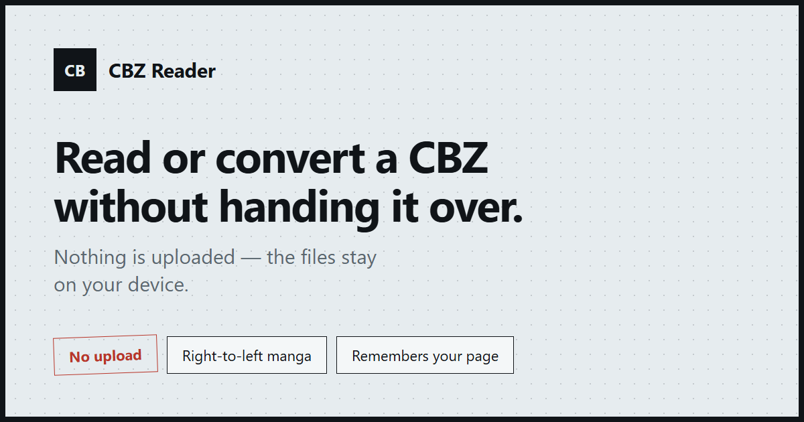

**English** | [简体中文](README.zh-CN.md)

# CBZ Reader — read or convert CBZ comics without uploading them

**Open a `.cbz` or `.zip` from your own disk, read it page by page, or turn it into a PDF — all inside the browser tab. The archive is never uploaded. No account, no install.**

[Try it](https://cbzreader.mavi.help/) · [Live demo — opens a sample comic](https://cbzreader.mavi.help/demo) · [How the local processing works](#verify-it-yourself-in-30-seconds)



<!-- TODO: replace this with a real in-app screenshot or a 10-second GIF: drop a .cbz, turn two pages, convert to PDF, then cut the network. The image above is the social share card, not the app. -->

Almost every "online CBZ reader" and "cbz to pdf" tool on the web asks you to hand the archive to a server: you upload, you wait in a conversion queue, you get a watermarked file back. CBZ Reader has no server to upload to. `zip.js` unpacks the archive in the tab, pages are decoded locally, and `pdf-lib` writes the PDF in that same tab.

## What that means in practice

- **Nothing is sent anywhere.** Not the archive, not a page image, not the converted PDF. There is no backend, no upload endpoint, no storage bucket, and no account.
- **It works with the network off.** After one visit the site is cached as a PWA; switch to airplane mode and local files still open, still read, still convert.
- **Nothing is re-compressed behind your back.** JPEG pages are embedded into the PDF as-is, so a conversion does not cost you a generation of image quality.

## Verify it yourself in 30 seconds

1. Open DevTools → **Network**, pick a local CBZ, turn a few pages, then convert it. Requests should be limited to the site's static assets and cookieless analytics — no request body contains the archive or page images.
2. Visit once, switch the device to **airplane mode**, reload the site, and open a local CBZ. Reading and conversion still work; only routes you never cached may show an offline notice.

If either check fails, the privacy claim is false — that is the whole point of writing it this way.

## How it compares

| | CBZ Reader | Desktop readers (Calibre, YACReader, CDisplayEx) | Online converters (Zamzar, CloudConvert and similar) |
| --- | --- | --- | --- |
| Where the file goes | stays in the tab | stays on disk | **uploaded to a server** |
| Install required | none | a desktop app | none |
| Works offline | yes (PWA) | yes | no |
| Right-to-left manga | yes, one toggle | usually | no |
| CBZ → PDF | in the tab, no queue | via a plugin or another tool | yes, usually with quotas or a watermark |
| Remembers your page | yes, per file, no account | yes | no |
| Cost | free, MIT | free (some are paid) | free tier with limits |
| CBR / CB7 input | ✗ | usually | sometimes |
| Huge scans (3000×4500+) | downsampled to fit a tab | full resolution | upload-limited |

A desktop reader is still the better tool for a permanent library of full-resolution scans. CBZ Reader is for the case in its tagline: a file that arrived, a machine that is not yours, and no desire to install anything or hand the archive to a stranger's server.

## Features

**Reading**

- Single page, true two-page spreads, or vertical continuous scrolling; pinch zoom 1x–4x, pan, swipe, click zones, keyboard navigation.
- Right-to-left reading for manga, one toggle.
- Resume the last page, mode, and reading direction per file — keyed to the archive's own content fingerprint, so re-selecting the same file restores your place even on iOS, where the browser cannot hand back a file handle.
- Page bookmarks, a thumbnail grid, and a Contents strip when the archive has folder chapters or `ComicInfo.xml` bookmarks.
- `ComicInfo.xml` metadata (title, series, number, summary) shown inside the reader.

**Converting**

- CBZ → PDF in the tab: original pixel size or fitted to A4, JPEG passthrough, PNG lossless embedding, page-by-page progress, and a working Cancel button.
- Guard rails instead of a crashed tab: oversized pages are detected from the image header before anything is decoded, and a failed page produces a real error message, not a blank screen.

**Privacy and offline**

- The archive is read with `zip.js` inside the tab, pages are decoded locally, and the PDF is assembled with `pdf-lib` in the same tab.
- Installable as a PWA; previously loaded pages reopen offline and local files still open with the network off.
- Analytics is cookieless and only ever reports the file extension and a size bucket — never a file name.

## Known limits

- **CBR (RAR) and CB7 (7z) input are not supported.** Browsers ship no RAR or 7z decoder. The reader and converter say so explicitly, and the [CBZ vs CBR comparison](https://cbzreader.mavi.help/cbz-vs-cbr/) explains the format differences. Renaming a `.cbr` to `.cbz` does not help — the container inside is still RAR.
- **Very large pages are downsampled** to a unified cap of 4096 px on the long edge and 12 MP, so 3000×4500 scans and larger may look softer when zoomed. One budget for every platform, so a phone and a desktop get the same pixels.
- **PDF output is images**, so text in the PDF is not selectable. No OCR, no text layer.
- **One archive at a time.** No batch conversion — that is what keeps memory bounded and Cancel meaningful.
- **iOS has only been tested on Safari 18** (iPhone 16e). Android Chrome has also been tested, but iOS file import, gestures, and very large archives still have unverified edges.

## Built with

Vue 3, TypeScript, and Vite 6, with `zip.js` for ZIP access, `pdf-lib` for PDF output, and `idb-keyval` for on-device progress and bookmarks. Pages are prerendered to static HTML, a service worker handles offline caching, and the site is deployed on Cloudflare Pages. MIT licensed.

### Run locally

Requires Node.js 20 or 22 and npm 10+.

```bash
npm install
npm run dev       # http://localhost:5173/
npm run build     # typecheck, build, and prerender
npm run preview   # preview the production build
```

### Tests

Optional, with Edge or Chrome installed:

```bash
npm run test:e2e
npm run test:offline
npm run test:convert
```

The test archives used for manual checks come from `npm run samples`, written to `test/.cache/samples` (git-ignored). Set `SAMPLE_OUT` (PowerShell: `$env:SAMPLE_OUT='D:\path'; npm run samples`) or pass `npm run samples -- --out <dir>` to use another directory.

## Sample comics

`public/samples/little-nemo-1908.cbz` contains 12 *Little Nemo in Slumberland* Sunday pages by Winsor McCay, published in the *New York Herald* in 1908. The Wikimedia Commons file pages ([source category](https://commons.wikimedia.org/wiki/Category:Little_Nemo_in_Slumberland,_1908)) carry `{{PD-US}}`, so the strips are in the U.S. public domain; they are not CC0 or CC BY. The pages were resized for the demo.

`public/samples/sample-large-20-pages.cbz` is generated by this repository's sample script from simple synthetic pages and contains no third-party artwork.

## License

The code in this repository is released under the [MIT License](LICENSE).

The files under `public/samples/` are sample content, not MIT-licensed software. `little-nemo-1908.cbz` keeps the U.S. public-domain status described above; `sample-large-20-pages.cbz` is generated demo content and is likewise excluded from the MIT License.
