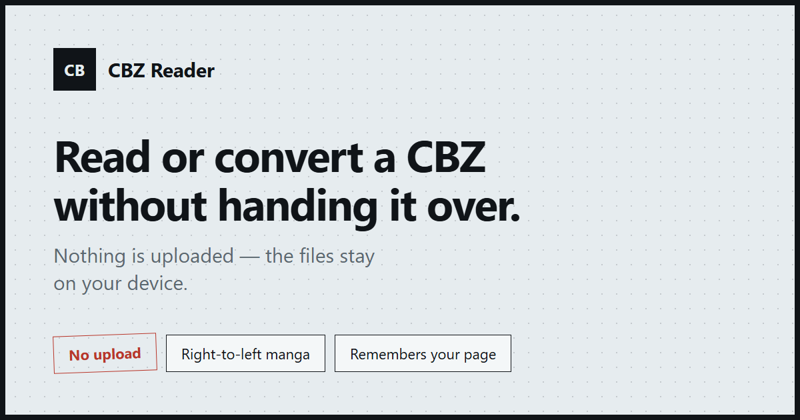

[English](README.md) | **简体中文**

# CBZ Reader —— 读或转 CBZ，不必把文件交出去

**在浏览器标签页里打开本地的 `.cbz` 或 `.zip`，一页页读，或者直接转成 PDF。压缩包不会被上传。无需账号，无需安装。**

[在线使用](https://cbzreader.mavi.help/) · [在线演示（打开一个示例漫画）](https://cbzreader.mavi.help/demo) · [怎么自己验证不上传](#自己花-30-秒验证)



<!-- TODO: 把这张换成真实的阅读器截图或 10 秒 GIF：拖入 .cbz → 翻两页 → 转 PDF → 断网。上面这张是社交分享图，不是应用内截图。 -->

网上绝大多数「在线 CBZ 阅读器」和「cbz 转 pdf」工具，都要你把压缩包交给一台服务器：先上传，再排队等转换，最后拿回一个带水印的文件。CBZ Reader 没有可以上传的服务器——`zip.js` 在标签页里解包，页面图片在本地解码，`pdf-lib` 在同一个标签页里写出 PDF。

## 这意味着什么

- **什么都不发出去**。不发压缩包、不发页面图片、不发转换后的 PDF。没有后端、没有上传接口、没有存储桶、没有账号。
- **断网也能用**。访问一次之后站点已经作为 PWA 缓存，切飞行模式后本地文件照样打开、照样阅读、照样转换。
- **不会偷偷重新压缩**。JPEG 页面原样嵌入 PDF，转换不会额外损失一代画质。

## 自己花 30 秒验证

1. 打开 DevTools → **Network**，选一个本地 CBZ，翻几页再转换一次。请求应该只有站点静态资源和不带 cookie 的统计脚本——没有任何请求体包含压缩包或页面图片。
2. 访问一次，把设备切到**飞行模式**，重新加载站点，再打开一个本地 CBZ。阅读和转换仍然可用；只有从未缓存过的路由可能会提示离线。

这两条只要有一条不成立，那句「不上传」就是假的——所以它才值得写在这里。

## 和竞品对比

| | CBZ Reader | 桌面阅读器（Calibre、YACReader、CDisplayEx） | 在线转换站（Zamzar、CloudConvert 之类） |
| --- | --- | --- | --- |
| 文件去了哪 | 只在本标签页 | 只在本机磁盘 | **上传到服务器** |
| 是否要安装 | 不需要 | 要装桌面软件 | 不需要 |
| 能否离线 | 能（PWA） | 能 | 不能 |
| 日漫右读 | 一个开关切换 | 一般支持 | 不支持 |
| CBZ → PDF | 标签页内完成，不排队 | 靠插件或另一款工具 | 支持，但常有配额或水印 |
| 记住读到哪一页 | 按文件记，不要账号 | 支持 | 不支持 |
| 费用 | 免费，MIT | 免费（部分收费） | 免费版有额度限制 |
| 支持 CBR / CB7 输入 | ✗ | 一般支持 | 部分支持 |
| 超大扫描件（3000×4500+） | 降采样以适应标签页 | 原始分辨率 | 受上传限制 |

如果你要长期收藏全分辨率扫描件，桌面阅读器仍然是更好的工具。CBZ Reader 面向的是它标题里那种场景：一个文件突然到了、这台机器不是你的、你既不想装软件，也不想把压缩包交给别人的服务器。

## 功能

**阅读**

- 单页、双页对开、竖向连读三种模式；双指缩放 1x–4x、拖动、滑动翻页、点击区域、键盘翻页。
- 一键切换到从右往左的日漫阅读方向。
- 按文件记住上次读到第几页、阅读模式和翻页方向——用的压缩包自身的内容指纹，所以重新选中同一个文件就能续读；iOS 上浏览器不给文件句柄，也照样能恢复。
- 页面书签、缩略图网格；当压缩包里带文件夹章节或 `ComicInfo.xml` 书签时，缩略图面板里会多出一条目录栏。
- 在阅读器内显示 `ComicInfo.xml` 元数据（标题、系列、期号、简介）。

**转换**

- 标签页内 CBZ → PDF：可选原始像素尺寸或适配 A4、JPEG 直通、PNG 无损嵌入、逐页进度和可用的取消按钮。
- 用护栏代替「浏览器卡死」：超大页面**在解码前就根据图片头识别**并处理，单页失败给出真实报错而不是黑屏。

**隐私与离线**

- 压缩包由 `zip.js` 在标签页内读取，页面在本地解码，PDF 在同一个标签页里用 `pdf-lib` 组装。
- 可安装为 PWA；此前加载过的页面离线可重开，断网时本地文件依然能打开。
- 统计不带 cookie，只上报文件扩展名和体积区间，从不上报文件名。

## 已知限制

- **不支持 CBR（RAR）和 CB7（7z）输入**。浏览器没有 RAR / 7z 解码器。阅读器和转换器会明说这一点，[CBZ vs CBR 对比](https://cbzreader.mavi.help/cbz-vs-cbr/) 里解释了格式差异。把 `.cbr` 改名成 `.cbz` 没用——里面的容器仍然是 RAR。
- **过大的页面会被降采样**，长边统一限制到 4096 px、总像素限制到 1200 万，所以 3000×4500 及更大的扫描件放大后可能偏软。所有平台共用同一套预算，手机和电脑得到同样的像素。
- **PDF 输出是图片**，所以 PDF 里的文字不能选中。没有 OCR，没有文字层。
- **一次一个压缩包**，不做批量转换——这才是内存可控、取消按钮真正有用的原因。
- **iOS 只在 Safari 18（iPhone 16e）上测试过**。Android Chrome 也测试过，但 iOS 的文件导入、手势和超大压缩包仍有尚未验证的边角情况。

## 技术栈

Vue 3、TypeScript 和 Vite 6，用 `zip.js` 读取 ZIP，用 `pdf-lib` 输出 PDF，用 `idb-keyval` 在设备上保存阅读进度和书签。页面预渲染为静态 HTML，service worker 负责离线缓存，站点部署在 Cloudflare Pages 上，MIT 开源。

### 本地运行

需要 Node.js 20 或 22，以及 npm 10 及以上。

```bash
npm install
npm run dev       # http://localhost:5173/
npm run build     # 类型检查、构建并预渲染
npm run preview   # 预览生产构建
```

### 测试

可选的检查，需已安装 Edge 或 Chrome：

```bash
npm run test:e2e
npm run test:offline
npm run test:convert
```

手动检查用的测试压缩包由 `npm run samples` 生成，写到 `test/.cache/samples`（已被 git 忽略）。设置 `SAMPLE_OUT`（PowerShell：`$env:SAMPLE_OUT='D:\path'; npm run samples`）或传入 `npm run samples -- --out <dir>` 可以改用其他目录。

## 示例漫画

`public/samples/little-nemo-1908.cbz` 包含 12 页 Winsor McCay 的《Little Nemo in Slumberland》周日版漫画，1908 年刊登在《New York Herald》上。Wikimedia Commons 的文件页面（[来源分类](https://commons.wikimedia.org/wiki/Category:Little_Nemo_in_Slumberland,_1908)）标注了 `{{PD-US}}`，因此这些漫画在美国属于公有领域；它们不是 CC0，也不是 CC BY 授权。页面为演示做过缩放。

`public/samples/sample-large-20-pages.cbz` 由本仓库的示例脚本从简单的合成页面生成，不包含任何第三方美术作品。

## 许可证

本仓库的代码以 [MIT License](LICENSE) 发布。

`public/samples/` 下的文件属于示例内容，不是 MIT 许可的软件。`little-nemo-1908.cbz` 保留上文所述的美国公有领域状态；`sample-large-20-pages.cbz` 是生成的演示内容，同样不包含在 MIT License 的覆盖范围内。
